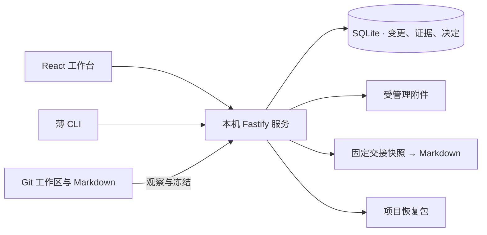
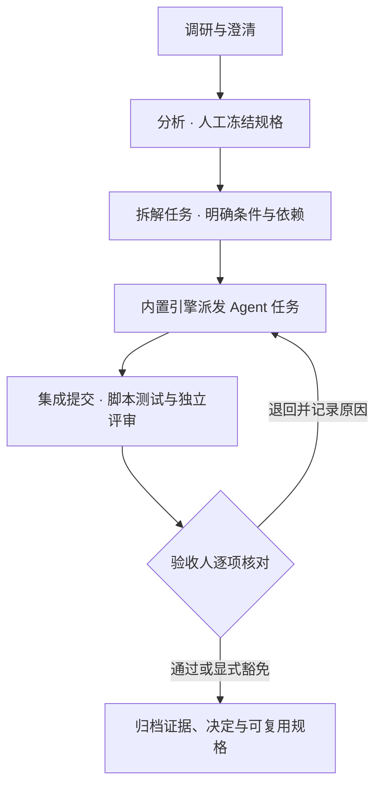

# SpecMill

SpecMill 让一次开发交付有据可查。打开一张变更单，可以看到采用了哪版规格、测试覆盖了哪个提交、哪些条件仍有缺口，以及谁作出了验收决定。

**现在可以使用本机工作台**，在不同会话和开发工具之间接续同一项变更。**团队版正在设计**，首个目标是由内置工作流引擎调度 Agent 和测试脚本，让团队从需求调研走到具名验收与归档。[团队版设计与验收标准](docs/05-团队工作流设计.md) · [LoopForge、Spec Kit 和 OpenSpec 对照](docs/06-开源项目对照.md)

## 现在能用它做什么

| 在工作中遇到的问题 | v0.1 的做法 |
| --- | --- |
| 开发过程中，需求文档变了 | 从仓库 Markdown 选择依据，冻结范围和验收条件。后续修订可显式采用 |
| 工具 A 做到一半，要交给工具 B | 保存当前工作区观察、已做事项、失败和下一步；从固定快照生成交接 Markdown，接手时核对实际工作区 |
| 测试全绿，却不清楚验的是哪一版 | 将外部执行记录、证据和附件关联到条件与实现目标。用户核对失败、补测和豁免后逐项或批量确认 |
| 想在另一套环境继续 | 导出项目记录和受管理附件，在隔离位置恢复，再绑定另行准备的源码仓库 |

目前使用者是同一台开发机上的一名开发者。服务只监听回环地址，工具共用本机 agent 凭据。真实异构双工具闭环与真实容量验收仍在跟踪。[使用记录与验证范围](docs/04-首版使用与验证.md) · [K18](https://github.com/destinyTaoTao/specmill/issues/19)

## 快速开始

已验证的开发环境为 Windows x64、Git 和 Node.js 24.x（最低 24.22.3）。在克隆后的仓库根目录执行：

```sh
npm ci
npm run build
npm start
```

打开终端打印的本机地址，使用同一终端的启动口令登录。默认数据目录为 Windows 的 `%LOCALAPPDATA%/SpecMill`。可用 `npm start -- --data-dir <目录> --port <端口>` 指定目录和端口；同一数据目录只允许一个服务实例。

**第一次试用**可以选一个已有 Git 仓库，其中包含一份写明预期行为的 Markdown。先在 Web 中登记项目和工作区，建立变更并冻结一个可测试条件。开始写会话，保存一个写明“接下来要验证什么”的保存点，然后生成交接快照。在另一个终端查看已登记的项目：

```sh
npm run cli -- project list --json
```

## 架构

### 本机版 · 已实现



代码编辑和测试在开发者选择的工具中完成。Web 与 CLI 通过同一服务写记录；正式验收绑定冻结基线和具体提交。写会话保护工作台内的写回，源码由 Git 和开发者管理。[服务入口](src/server/app.ts) · [首版详细设计](docs/02-首版详细设计.md)

### 团队版 · 拟议工作流



团队版会把调度记录和验收证据连起来。比如两名 Agent 在各自分支完成任务，调度器要等改动集成后，才能在同一提交上验证整条需求。若测试失败，返工产生新的执行尝试，审阅者仍可看到最初的失败。首个试点将验证真实 Agent 调度、人工退回、Worker 中断恢复与最终放行。团队身份、隔离 Worker、调度器和性能门槛均属于提案。[设计、取舍及试点](docs/05-团队工作流设计.md)

## 开发与验证

| 命令 | 检查内容 |
| --- | --- |
| `npm test` | 工作区、基线、写会话、审阅、恢复等集成测试 |
| `npm run lint` / `npm run typecheck` | 静态规则与类型检查 |
| `npm run build` | 编译服务、CLI 和 Web |
| `npm run test:e2e` | 浏览器流程；需安装 Playwright Chromium 或设置 `SPECMILL_TEST_CHROME` 指向本机 Chrome |
| `npm run verify:package` | 在隔离目录验证打包、安装、启动、CLI 与最小续做流程 |

<details>
<summary>CLI 写授权、审阅预览和请求回执</summary>

构建后可通过 `npm run cli -- project list --json` 查看项目，再使用 `workspace list --project <项目ID>`、`change list --project <项目ID>`、`change show --change <变更ID>`、`checkpoint list --change <变更ID>`、`handoff show --snapshot <快照ID>` 查询交接材料。`handoff create`、`attachment add`、`review preview`、`review disposition-preview`、`run add`、`evidence add`、`target add` 和 `proposal submit` 需要传入当前写会话的 `--grant-file <授权文件>`；附件上传的会话必须属于目标项目，审阅阶段也可以开始或接管写会话。`target add` 不指定工作区时使用授权会话绑定的工作区。CLI 的会话、观察、保存点、回执命令及其当前限制见交接文档。CLI 只访问本机服务；新服务写出的 CLI 凭据绑定其监听端口，数据目录与 `--server` 端口不一致时会在发送请求前拒绝。旧格式凭据仍可读取，但没有端口绑定；请同时更新服务与 CLI。端口绑定不能认证占用该端口的进程。Windows 下凭据及 CLI 的标准输入暂存使用当前 Windows 用户的系统加密。

CLI 生成审阅预览前，可先把 `review show --change <变更ID> --json` 的输出保存为文件，再以 `review preview --change <变更ID> --grant-file <授权文件> --file <选择文件> --review-file <审阅状态文件> --request-id <请求ID>` 提交。服务会核对保存的审阅快照；状态变化时须重新查看并生成预览。`--review-file` 可以省略，但无法获得此跨请求校验；写操作仍需 `--grant-file`。审阅状态文件可能包含工作区路径和证据内容，应按本地工作台数据保护。

`receipt show --request-id <请求标识>` 可查询附件、交接、执行、证据、目标候选、验收建议和审阅操作的通用回执；目标确认返回确认时间，导出返回操作标识及当前状态。导出操作状态只在本机保留，不进入恢复包。这不代替读取当前审阅状态。恢复操作提交后可在工作台查询持久回执；同一请求标识和相同包可安全重放，旧版已完成的恢复没有追溯回执。

</details>

<details>
<summary>容量边界、旧数据兼容与恢复</summary>

旧数据中有多个已确认目标时，无法可靠还原确认先后，工作台要求用户重新生成候选并确认。历史失败处置若未保存目标，仍可查看，但不会解除当前目标下的失败阻塞，须重新处置。写会话保护工作台内的进度和工具记录，不是文件系统锁，不能阻止外部进程直接修改源码。多个本机工具共用服务的 agent 凭据：它不提供工具之间的身份隔离，持有该凭据者仍能读取工作台数据，并可在无活跃会话时按规则申请新会话。

每个项目最多新增 9,998 个不同内容的受管理附件；同一内容去重，历史数据不删除，超限历史项目不能再增加不同附件。恢复兼容最多 65,535 个 ZIP 文件项的历史包，仍受包体 64 MiB、本地项目预算及格式校验限制；旧版本可能无法恢复超过其文件项限制的包。

数据库由 v16 或 v17 升级到 v18 前，服务会在数据目录的 `backups` 下备份升级前数据库；该文件只包含数据库，不包含附件。新版可恢复符合校验和本地容量限制的 v16、v17 和 v18 恢复包；旧版不能读取 v18 数据库或恢复包。回退需停机并使用升级前的应用及配套数据库／附件备份，升级后产生的新记录不会自动合并到旧备份。

保存点提交结果未知时，浏览器会把未决正文保存在当前标签页的会话存储中（关闭标签页即清除，刷新后仍可恢复），并在站点存储中保留不含正文的请求标识用于核对回执；这些副本**不在工作台数据目录或恢复包中**。确认保存结果后只清理自身请求的记录；同一变更的多个标签页互不覆盖彼此的未决请求。不要把敏感信息放入进度正文，详见交接文档。

服务被强制终止后，确认旧进程已退出，等待单实例锁释放再启动。

</details>

<details>
<summary>本地安装包</summary>

`npm run build && npm pack` 生成 `specmill-<版本>.tgz`，内容仅含编译后的服务（dist-server）、静态页面（dist）、CLI（dist-cli）与 README；不含个人数据库、凭据、附件、测试产物或源码。`npm run verify:package` 在隔离目录完成打包内容检查、安装（先严格离线，失败后允许联网并记录结果）、从安装产物启动服务、登录/项目/会话/保存/交接最小闭环与静态页面验证。

安装使用：在目标目录 `npm install <tgz>` 后，`npx specmill --data-dir <目录> --port <端口>` 启动服务（登录口令打印在终端），`npx specmill-cli <命令> --data-dir <目录> --server http://127.0.0.1:<端口>` 调用 CLI。启动前需 Node 24.x 与 Git；better-sqlite3 为原生模块，安装时可能需要网络下载预编译产物。停止服务直接结束进程（Ctrl+C）；重启后口令与浏览器会话失效、活跃写会话标记中断，数据目录与单实例锁约定与开发运行一致。恢复包仅含工作台记录与受管理附件，不含源码。

</details>

## 项目文档

- [团队工作流设计、现状复盘与验收标准](docs/05-团队工作流设计.md)
- [开源项目的具体做法与取舍](docs/06-开源项目对照.md)
- [首版愿景](docs/01-项目愿景与方案总览.md) · [技术选型](docs/03-首版技术选型.md) · [设计决定](docs/adr)
- [领域词汇表](GLOSSARY.md) · [首版实施计划](docs/superpowers/plans/2026-11-14-v0.1-minimum-loop.md) · [实施交接](docs/agents/2026-11-15-mvp-handoff.md)
