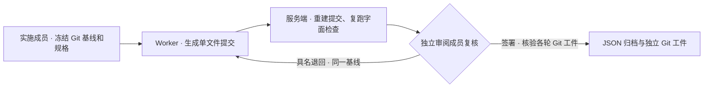
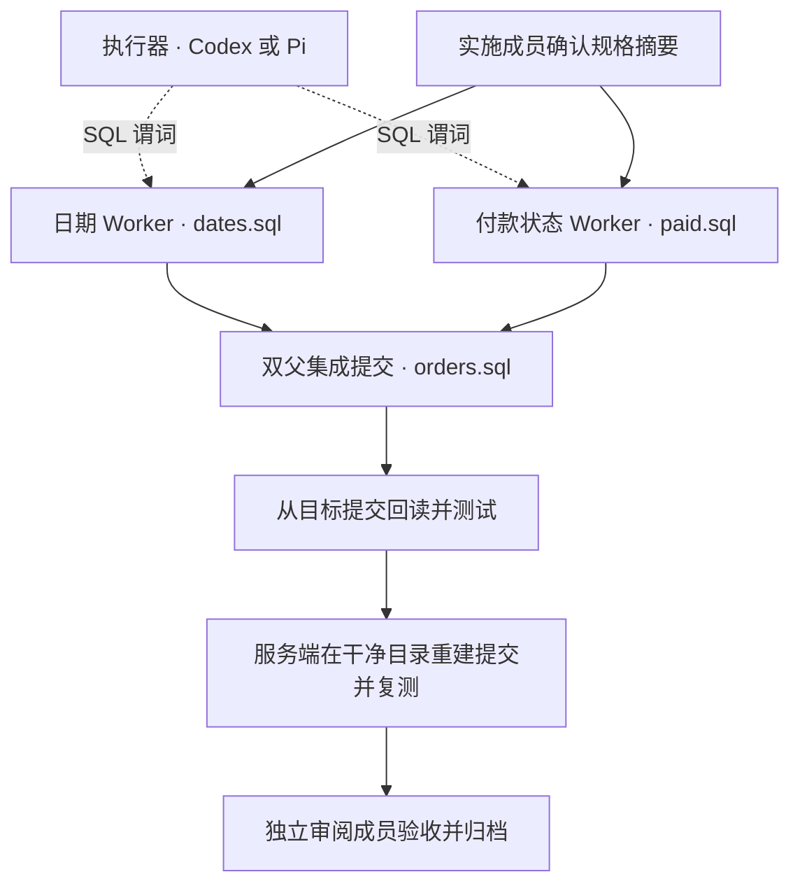
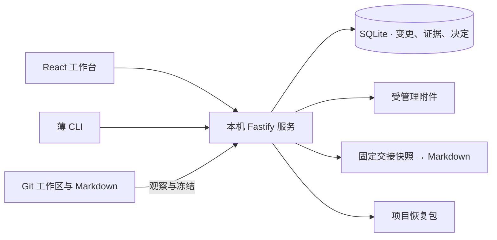
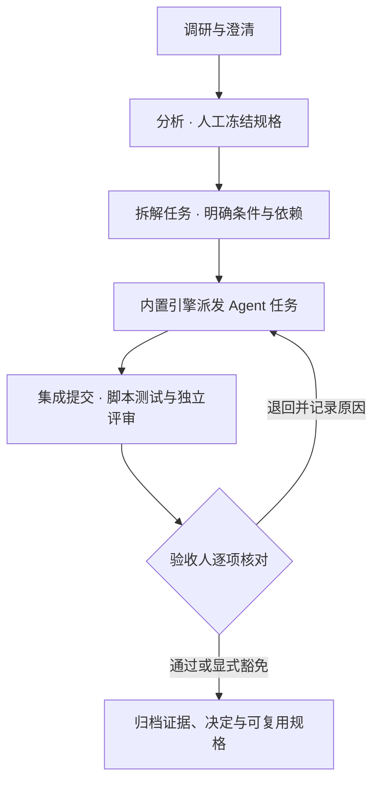

# SpecMill

SpecMill 让一次开发交付有据可查。打开一张变更单，可以看到采用了哪版规格、测试覆盖了哪个提交、哪些条件仍有缺口，以及谁作出了验收决定。

**本机工作台**支持跨会话接续开发。**团队试点**让具名成员按项目分工，用 Codex 或 Pi 执行冻结任务，由另一名成员核对具体提交、退回复测或签署归档。[团队试点使用说明](#团队试点) · [团队版设计与验收标准](docs/05-团队工作流设计.md) · [同类开源项目对照](docs/06-开源项目对照.md)

## 现在能用它做什么

| 在工作中遇到的问题 | v0.1 的做法 |
| --- | --- |
| 开发过程中，需求文档变了 | 从仓库 Markdown 选择依据，冻结范围和验收条件。后续修订可显式采用 |
| 工具 A 做到一半，要交给工具 B | 保存当前工作区观察、已做事项、失败和下一步；从固定快照生成交接 Markdown，接手时核对实际工作区 |
| 测试全绿，却不清楚验的是哪一版 | 将外部执行记录、证据和附件关联到条件与实现目标。用户核对失败、补测和豁免后逐项或批量确认 |
| 想在另一套环境继续 | 导出项目记录和受管理附件，在隔离位置恢复，再绑定另行准备的源码仓库 |

个人工作台面向同一台开发机上的一名开发者，工具共用本机 agent 凭据。团队试点使用独立的具名成员凭据，服务监听回环地址。个人工作台的真实异构双工具闭环与真实容量验收仍在跟踪。[使用记录与验证范围](docs/04-首版使用与验证.md) · [K18](https://github.com/destinyTaoTao/specmill/issues/19)

## 快速开始

已验证的开发环境为 Windows x64、Git 和 Node.js 24.x（最低 24.22.3）。在克隆后的仓库根目录执行：

```sh
npm ci
npm run build
npm start
```

打开终端打印的本机地址，使用同一终端的启动口令登录。默认数据目录为 Windows 的 `%LOCALAPPDATA%/SpecMill`。可用 `npm start -- --data-dir <目录> --port <端口>` 指定目录和端口；同一数据目录只允许一个服务实例。

**第一次试用**可以选一个已有 Git 仓库，其中包含一份写明预期行为的 Markdown。先在 Web 中登记项目和工作区，建立变更并冻结一个可测试条件。开始写会话，保存一个写明“接下来要验证什么”的保存点，然后生成交接快照。在另一个终端查看已登记的项目：

```sh
npm run cli -- project list --json
```

## 试用内置 Agent 工作流

试点使用合成订单表，任务是编写“查询指定日期范围内的已付款订单 ID”的 SQL。它只在传入 `--pilot-agent` 时启用。以下为 Windows x64、npm 全局安装 Codex CLI 的示例。先完成上面的构建，并用 `codex login status` 确认本机已登录；本次实测使用 Codex CLI 0.169.0。

```powershell
$pilotAgent = Join-Path (npm root -g) '@openai/codex/node_modules/@openai/codex-win32-x64/vendor/x86_64-pc-windows-msvc/bin/codex.exe'
$pilotData = Join-Path $env:LOCALAPPDATA 'SpecMill-Pilot'
npm start -- --pilot-agent "$pilotAgent" --data-dir "$pilotData" --port 43128
```

如果使用其他方式安装 Codex，传入对应的原生可执行文件绝对路径。Worker 通过只读、临时的 Codex 会话提交固定样例和返工意见，关闭 shell 和外部工具集成，并忽略用户 CLI 配置。需要可用的模型服务和登录凭据，真实调用消耗相应额度。

1. 在浏览器登录，进入 **团队工作流试点**，创建试运行。核对合成调研来源、业务日期口径和三个验收条件，勾选确认并冻结。冻结说明只留在本机。
2. 等待 Worker 在独立 Git 仓库提交 `orders.sql`。工作台会展示测试所用的完整提交、SQL 及每项检查的预期与实际 ID。
3. 选择 **退回返工**，输入需要修改的具体理由，例如将日期范围改写为两个显式比较。Worker 会获得上一次的 SQL 和这条意见，生成新的提交并复测。两次尝试都保留。
4. 对当前目标核对三项证据，填写验收理由并确认。点击 **下载验收归档（JSON）**，即可带走规格、摘要、SQL、提交标识、断点和全部决定。

试点每次只派发一个 Worker。异常退出或服务重启后，调度器记录旧尝试中断并重新派发，每次运行最多自动重试两次、完成人工审阅的执行轮次最多三轮。试点台账和样例仓库位于指定数据目录的 `pilot/`。单次 JSON 归档供独立查阅；完整保留试点现场需停服备份该目录，v0.1 的项目恢复包仅覆盖原工作台项目。

**2026-11-21 实机演练。** 正常运行、人工退回重做、真实 Worker 被强制终止后重派，三个目标均经用户确认并生成归档。返工将 `BETWEEN` 改为 `>=`、`<=`；中断发生时 Codex 正在执行，旧 Agent 和守护进程均已退出。最终将三个目标分别从 Git 提交读回，在含退款订单的测试数据上核对，实际 ID 均为 `[10,20]`、`[30]`、`[2,5,9]`。身份仍为本机 owner，当前试点只对固定 SQL 样例提供执行能力。[Worker 与样例](src/server/pilot) · [故障恢复测试](tests/integration/pilot-api.test.ts) · [浏览器验收流程](tests/e2e/pilot.spec.ts)

## 团队试点

团队试点沿用上面的 Windows、Node、Git 和 Codex CLI 环境。使用独立数据目录启动，在浏览器中打开 `http://127.0.0.1:43129/?team`。

```powershell
$teamAgent = Join-Path (npm root -g) '@openai/codex/node_modules/@openai/codex-win32-x64/vendor/x86_64-pc-windows-msvc/bin/codex.exe'
$teamData = Join-Path $env:LOCALAPPDATA 'SpecMill-Team'
npm start -- --team-agent "$teamAgent" --data-dir "$teamData" --port 43129
```

也可以选择 **Pi Coding Agent**。安装 Pi CLI 后，先在当前机器确认 `pi auth check --model deepseek/deepseek-flash` 返回 `ready`。下面使用 npm 全局安装的 Pi 1.5.2 和 DeepSeek Flash，凭据由 Pi 从本机登录配置或服务进程的 `DEEPSEEK_API_KEY` 取得。[Pi CLI 文档](https://github.com/earendil-works/pi/blob/main/packages/coding-agent/docs/cli.md)

```powershell
$piAgent = Join-Path (npm root -g) '@earendil-works/pi-coding-agent/dist/bundle/cli.js'
npm start -- --team-agent "$piAgent" --team-executor pi --team-model deepseek/deepseek-flash --data-dir "$teamData" --port 43129
```

每次启动选择一种执行器，`--team-executor` 默认 `codex`。Worker 禁用模型工具和会话持久化，由 SpecMill 生成提交并复核证据。任务证据记录执行器、协议版本、耗时及 CLI 提供的用量。Pi 还记录实际模型和 CLI 估算费用。

管理员在团队入口创建项目和两个具名成员，分别授予项目开发、审阅权限。签发时显示成员凭据，账本保存凭据摘要。两位成员用各自凭据登录。

### 真实仓库单文件试点

管理员先按上面的命令启动并创建项目，再准备一份仓库授权 JSON。授权文件放在 Git 仓库之外，填写管理员入口中的项目 ID、已批准的仓库绝对路径、完整基线 SHA-1 和目标文件。

```json
{
  "projectId": "实际项目ID",
  "source": "C:/repos/specmill",
  "spec": {
    "kind": "repository-v1",
    "title": "补齐合并复核说明",
    "requirement": "在文末增加合并前复核小节，说明如何在实际集成提交上复跑检查、记录提交 SHA 和结果，保留原有决定。",
    "baseCommit": "9f0cac25f8427d618580b836998f8b46871bd6c8",
    "path": "docs/adr/0006-project-capacity-and-independent-changes.md",
    "checks": [
      { "name": "复核小节", "text": "## 合并前复核", "present": true },
      { "name": "保留独立验收决定", "text": "**Q18：不同变更独立冻结与验收。**", "present": true }
    ]
  }
}
```

停止服务后沿用原数据目录和团队启动参数，添加 `--team-repository "<授权 JSON 的绝对路径>"`。服务为授权文件指定的一个项目显示仓库规格。普通本机 Git 仓库和裸仓库均可作为来源。目标必须是基线提交里的普通 UTF-8 文本文件，单文件上限 4 KiB，审计 Git 包上限 16 MiB。数据目录和临时目录位于来源仓库之外。

1. 实施成员核对规格摘要和基线，冻结并派工。Agent 接收授权目标文件、冻结要求和检查项，返工时同时接收上次候选内容和退回理由。
2. Worker 在独立浅仓库生成候选提交。服务端重建提交，回读目标文件并执行区分大小写的字面检查。试点使用字面检查作为复测，仓库脚本由团队在既有测试环境运行。
3. 审阅成员核对当前版本、提交和差异。填写理由可退回，下一代 Worker 从同一基线重新派工。全部冻结检查通过后，审阅成员仍需核对实际退回项，填写理由并签署。
4. 下载验收归档 JSON。每轮 Git 工件在 `<数据目录>/team/workspaces/<repositoryArtifact>`，目录名记录在归档的 `attempts` 中。签署前服务复核所有已产出工件。完整备份需停服并复制 `team/`，其中包含具名授权、台账和 Git 工件。



**ADR-0006 自动化演练。** 使用两个测试身份与确定性的 Pi 协议替身，在 SpecMill 自己仓库的固定基线复验五项规格。首轮 `1525f5b0` 通过 4 项，缺少集成提交复测说明，签署被拒绝。具名退回后，第二轮 `801fed09` 通过全部 5 项，签署绑定第二轮版本及提交。两份 Git 工件均从对象独立读回，归档在重启后保持一致。另一次真实 Pi 返工通过五项字面检查，但遗漏退回要求新增的示例，该运行留在待复核。双真人试点仍作为独立验收事项。[仓库 Worker 与工件测试](tests/integration/team-repository.test.ts) · [团队 API 测试](tests/integration/team-api.test.ts) · [浏览器复核流程](tests/e2e/team-repository.spec.ts)

### 并行订单样例

未配置仓库规格的团队项目使用固定订单样例。实施成员冻结并派工，Worker 分别生成日期筛选和付款状态谓词。审阅成员核对集成提交、两个父提交、组合后的 SQL 和三个条件的预期及实际结果，填写理由并签署。



项目角色支持开发、审阅或兼任。兼任者仍须回避本人负责的运行。授权撤销对下一次请求和幂等重试立即生效，失效代次的 Worker 不能推进任务。每个项目最多有 16 个排队或运行中的变更，且最多同时运行 2 个任务。团队按项目轮转派发，`--team-workers` 可设置全局并发 1 至 8，默认 2。集成证据不合格时，运行进入阻断状态，保留失败原因供核对。

**切片 B 实机验证（2026-11-21）。** 两个独立演练账号完成分工与验收，两个原生 Codex 进程重叠运行 5.284 秒。集成提交 `26d4d03c` 的父提交为 `b3ca7517` 和 `21b380ad`。从集成提交回读的 SQL 得到 `[10,20]`、`[30]`、`[2,5,9]`。跨项目读写与下载、撤权后审批、实现人自签和旧代次写回均被拒绝。[授权与恢复测试](tests/integration/team-api.test.ts) · [迟到写回测试](tests/integration/team-ledger.test.ts) · [Git 对象复核测试](tests/integration/team-proof.test.ts)

**切片 C 实机验证（2026-11-21）。** Codex 与 Pi 均通过同一套真实执行器契约，从冻结派工走到集成复测和归档。10 项目、预置 1 万条运行的账本长测中，活跃索引把吞吐从 13.5 提到 693.0 ops/s，领取 p95 从 1.31 秒降到 18.33 ms。回环 HTTP 持续试验中，100 个轮询客户端与 6 个 Worker 在 4 个逻辑处理器、8 GiB 进程树限制下完成 539 个归档。完整数据和复现命令见报告。[共享契约测试](tests/integration/team-executor-contract.test.ts) · [切片 C 验证与性能](docs/07-切片C验证与性能.md)

**第二轮性能复测。** 账本 15 分钟实测平均接近 1,000 ops/s。批量 Git 对象写入和回读让 Worker 集成 p95 从 1.50 秒降到 579 ms，服务端独立重建复测 p95 从 1.51 秒降到 266 ms。30 组对照的提交和验收结果一致。回环 HTTP 使用相同资源上限及负载参数，归档吞吐从 0.573 提到 1.621 个/s，最长首次排队从 46.64 秒降到 16.10 秒。[第二轮性能复测](docs/07-切片C验证与性能.md#第二轮性能复测)

团队入口使用回环地址和同机服务。团队数据及工件应按项目私有数据保管。并行样例已验证将整个 `team/` 复制到干净数据目录并重启后，成员授权和已验收归档仍可读取。

## 架构

### 本机版 · 已实现



代码编辑和测试在开发者选择的工具中完成。Web 与 CLI 通过同一服务写记录；正式验收绑定冻结基线和具体提交。写会话保护工作台内的写回，源码由 Git 和开发者管理。[服务入口](src/server/app.ts) · [首版详细设计](docs/02-首版详细设计.md)

### 团队版 · 拟议工作流



切片 A 已实现单任务返工。切片 B 已实现固定任务图、按项目授权的并行派工和独立验收。切片 C 增加第二个执行器和实测负载指标。真实仓库试点覆盖单文件的具名退回、重新派发和归档。设计还规划了可配置工作流与跨机 Worker。[设计、取舍及试点](docs/05-团队工作流设计.md)

## 开发与验证

| 命令 | 检查内容 |
| --- | --- |
| `npm test` | 工作区、基线、写会话、审阅、恢复等集成测试 |
| `npm run lint` / `npm run typecheck` | 静态规则与类型检查 |
| `npm run build` | 编译服务、CLI 和 Web |
| `npm run test:e2e` | 浏览器流程；需安装 Playwright Chromium 或设置 `SPECMILL_TEST_CHROME` 指向本机 Chrome |
| `npm run verify:package` | 在隔离目录验证打包、安装、启动、CLI 与最小续做流程 |

<details>
<summary>CLI 写授权、审阅预览和请求回执</summary>

构建后可通过 `npm run cli -- project list --json` 查看项目，再使用 `workspace list --project <项目ID>`、`change list --project <项目ID>`、`change show --change <变更ID>`、`checkpoint list --change <变更ID>`、`handoff show --snapshot <快照ID>` 查询交接材料。`handoff create`、`attachment add`、`review preview`、`review disposition-preview`、`run add`、`evidence add`、`target add` 和 `proposal submit` 需要传入当前写会话的 `--grant-file <授权文件>`；附件上传的会话必须属于目标项目，审阅阶段也可以开始或接管写会话。`target add` 不指定工作区时使用授权会话绑定的工作区。CLI 的会话、观察、保存点、回执命令及其当前限制见交接文档。CLI 只访问本机服务；新服务写出的 CLI 凭据绑定其监听端口，数据目录与 `--server` 端口不一致时会在发送请求前拒绝。旧格式凭据仍可读取，但没有端口绑定；请同时更新服务与 CLI。端口绑定不能认证占用该端口的进程。Windows 下凭据及 CLI 的标准输入暂存使用当前 Windows 用户的系统加密。

CLI 生成审阅预览前，可先把 `review show --change <变更ID> --json` 的输出保存为文件，再以 `review preview --change <变更ID> --grant-file <授权文件> --file <选择文件> --review-file <审阅状态文件> --request-id <请求ID>` 提交。服务会核对保存的审阅快照；状态变化时须重新查看并生成预览。`--review-file` 可以省略，但无法获得此跨请求校验；写操作仍需 `--grant-file`。审阅状态文件可能包含工作区路径和证据内容，应按本地工作台数据保护。

`receipt show --request-id <请求标识>` 可查询附件、交接、执行、证据、目标候选、验收建议和审阅操作的通用回执；目标确认返回确认时间，导出返回操作标识及当前状态。导出操作状态只在本机保留，不进入恢复包。这不代替读取当前审阅状态。恢复操作提交后可在工作台查询持久回执；同一请求标识和相同包可安全重放，旧版已完成的恢复没有追溯回执。

</details>

<details>
<summary>容量边界、旧数据兼容与恢复</summary>

旧数据中有多个已确认目标时，无法可靠还原确认先后，工作台要求用户重新生成候选并确认。历史失败处置若未保存目标，仍可查看，但不会解除当前目标下的失败阻塞，须重新处置。写会话保护工作台内的进度和工具记录，不是文件系统锁，不能阻止外部进程直接修改源码。多个本机工具共用服务的 agent 凭据：它不提供工具之间的身份隔离，持有该凭据者仍能读取工作台数据，并可在无活跃会话时按规则申请新会话。

每个项目最多新增 9,998 个不同内容的受管理附件；同一内容去重，历史数据不删除，超限历史项目不能再增加不同附件。恢复兼容最多 65,535 个 ZIP 文件项的历史包，仍受包体 64 MiB、本地项目预算及格式校验限制；旧版本可能无法恢复超过其文件项限制的包。

数据库由 v16 或 v17 升级到 v18 前，服务会在数据目录的 `backups` 下备份升级前数据库；该文件只包含数据库，不包含附件。新版可恢复符合校验和本地容量限制的 v16、v17 和 v18 恢复包；旧版不能读取 v18 数据库或恢复包。回退需停机并使用升级前的应用及配套数据库／附件备份，升级后产生的新记录不会自动合并到旧备份。

保存点提交结果未知时，浏览器会把未决正文保存在当前标签页的会话存储中（关闭标签页即清除，刷新后仍可恢复），并在站点存储中保留不含正文的请求标识用于核对回执；这些副本**不在工作台数据目录或恢复包中**。确认保存结果后只清理自身请求的记录；同一变更的多个标签页互不覆盖彼此的未决请求。不要把敏感信息放入进度正文，详见交接文档。

服务被强制终止后，确认旧进程已退出，等待单实例锁释放再启动。

</details>

<details>
<summary>本地安装包</summary>

`npm run build && npm pack` 生成 `specmill-<版本>.tgz`，内容仅含编译后的服务（dist-server）、静态页面（dist）、CLI（dist-cli）与 README；不含个人数据库、凭据、附件、测试产物或源码。`npm run verify:package` 在隔离目录完成打包内容检查、安装（先严格离线，失败后允许联网并记录结果）、从安装产物启动服务、登录/项目/会话/保存/交接最小闭环与静态页面验证。

安装使用：在目标目录 `npm install <tgz>` 后，`npx specmill --data-dir <目录> --port <端口>` 启动服务（登录口令打印在终端），`npx specmill-cli <命令> --data-dir <目录> --server http://127.0.0.1:<端口>` 调用 CLI。启动前需 Node 24.x 与 Git；better-sqlite3 为原生模块，安装时可能需要网络下载预编译产物。停止服务直接结束进程（Ctrl+C）；重启后口令与浏览器会话失效、活跃写会话标记中断，数据目录与单实例锁约定与开发运行一致。恢复包仅含工作台记录与受管理附件，不含源码。

</details>

## 项目文档

- [团队工作流设计、现状复盘与验收标准](docs/05-团队工作流设计.md)
- [开源项目的具体做法与取舍](docs/06-开源项目对照.md)
- [首版愿景](docs/01-项目愿景与方案总览.md) · [技术选型](docs/03-首版技术选型.md) · [设计决定](docs/adr)
- [领域词汇表](GLOSSARY.md) · [首版实施计划](docs/superpowers/plans/2026-11-14-v0.1-minimum-loop.md) · [实施交接](docs/agents/2026-11-15-mvp-handoff.md)
