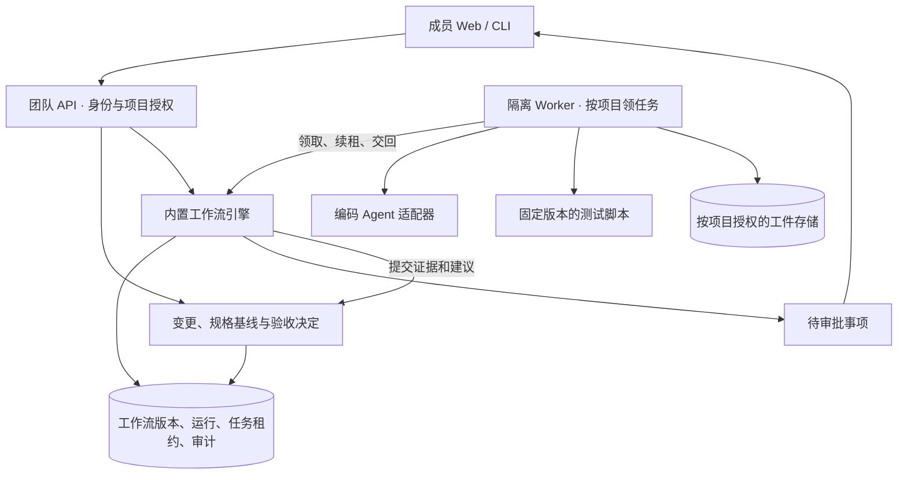

# 团队版设计提案 · 从需求调查到可复核的交付

2026-11-21。产品方向是**优先内置工作流执行与 Agent 调度**。切片 A 已用真实 Codex CLI 完成正常交付、人工返工与中断恢复。切片 B 已在本机固定样例实现具名成员、项目授权、两个 Worker 并行、集成提交复测与独立账号验收。当前证据覆盖两个演练账号及干净目录恢复，两名真实成员参与仍是单列的试点验收项。[切片 B 使用与验证](../README.md#团队试点切片-b) · [切片 A 使用与验证](../README.md#试用内置-agent-工作流) · [开源项目对照](06-开源项目对照.md)

## 定位与取舍

团队把一个需求交给 SpecMill 后，应当能随时回答三个问题：下一步由谁做、哪一条依据允许它继续、出了问题能退回哪里。调度器负责让工作向前走；变更单保留团队为什么接受这次交付的证据。即使执行器已下线，另一名成员也应能从归档还原决定。

| 路径 | 适用情形 | 本次取舍 |
| --- | --- | --- |
| Git 模板与 PR 约定 | 团队主要缺少需求和拆解方法 | 用于编写规格，人工负责交接、重试与归档 |
| 接入既有 CI，由工作台收集证据 | 已有稳定编排，只缺条件级验收 | 保留为证据接入方式，调度仍依赖外部系统 |
| 内置工作流引擎，隔离 Worker 执行 | 团队希望系统能实际派工、暂停问人、返工和恢复 | **首选**。服务承担租约、资源配额和故障恢复成本；先跑通一条固定流程，再开放自定义 |

## 现有实现复盘

下表按对团队试点的影响排序。“缺口”指在团队部署条件下需要补齐的能力。

| 优先级 | 代码证据与触发条件 | 影响与处理 |
| --- | --- | --- |
| 阻断 | 服务监听回环地址，路由按本机 owner／agent 放行，审阅主体记录为 user／agent。两人共用服务时无法区分个人。[启动](../src/server/main.ts) · [请求权限](../src/server/app.ts) · [审阅](../src/server/features/review.ts) | 无法证明谁批准了什么，也无法按成员撤权。团队入口引入具名身份、项目成员关系和服务端授权，覆盖读取、搜索、下载及写入 |
| 阻断 | 写授权核对变更、会话代次和工作区绑定；现有执行记录由调用方上报。并行 Agent 共用一个变更写授权会失去归属。[写入守卫](../src/server/features/writer-guard.ts) · [执行记录](../src/server/features/evidence.ts) | 保留变更决策的串行边界；另建节点尝试和限域租约，每个尝试独立 checkout，归并时针对集成提交复测 |
| 高 | 启动、鉴权、路由装配和数据库迁移集中在服务入口；SQLite 使用独占锁；ZIP 在进程内组装为 Buffer。[服务装配](../src/server/app.ts) · [ZIP](../src/server/recovery/zip.ts) | 多 API 实例或大批量工件会越过原设计边界。先提取命令事务和调度存储；大文件走独立工件存储；扩容前量测锁等待、事件循环延迟、内存和排队时间 |
| 保留 | 基线保存选定来源，审阅按条件、基线、目标与周期核对；预览过期可拒绝，失败处置留痕，项目可隔离恢复。[基线](../src/server/features/baselines.ts) · [审阅测试](../tests/integration/review.test.ts) · [恢复测试](../tests/integration/recovery-import.test.ts) | 复用这些语义和回归用例。新增引擎只能产生运行记录、证据和建议，领域服务负责决定证据能否用于本次验收 |

ADR-0001 至 0006 继续描述 v0.1。团队版扩大了个人续做、本机部署、外部执行的范围；沿用它们对冻结版本、人工决定、记录归属和恢复的约定。团队版的 Worker 租约只授权写入自己的尝试，现有写会话仍控制本机变更写回。[首版决定](adr/0001-v01-continuation-acceptance-portability.md) · [本机交互](adr/0002-local-draft-continuation-human-decisions.md) · [写会话](adr/0003-recovery-single-writer-checkpoints.md) · [记录边界](adr/0005-record-boundaries-workspace-rebinding-failure-disposition.md)

## 一项需求如何流转

以下用“给订单列表增加按日期导出”举例。表中角色可以由同一团队成员兼任；试点的最终验收人与实现提交人分开。每一步都能查到输入版本、产物引用和责任主体。

| 阶段 | 谁做什么 | 留下什么，什么情况下继续 |
| --- | --- | --- |
| 调研 | 需求负责人核对客服反馈和业务样本；研究 Agent 整理分歧 | 记录脱敏来源、受影响角色、成功指标和待答问题。日期按哪个时区解释尚不清楚时，工作流暂停等负责人答复 |
| 分析与冻结 | 分析 Agent 草拟范围、替代方案、验收条件；规格负责人审阅 | 冻结基线 B1。C1 要求按业务时区包含结束日；C2 要求无权用户无法导出。理由、非目标和批准人进入历史 |
| 拆解 | 计划节点把条件映射到有负责人、依赖和预期证据的任务；技术负责人核对覆盖率 | T1 实现筛选，T2 补权限测试，可并行。若有条件无人验证或任务依赖成环，计划退回修订 |
| 开发 | 引擎派发 T1、T2，各 Worker 按冻结输入领取尝试；开发者审阅分支改动 | 每项交回差异、完整提交标识和执行摘要。冲突交给集成人处理；集成完成后明确记录候选目标 H1 |
| 测试与对抗评审 | 脚本节点在 H1 上验证 C1/C2；独立审阅者检查跨日、权限反例及原始报告 | 条件、命令版本、目标、结果和工件摘要相关联。C2 失败则回到对应任务；生成 H2 后重新评估旧证据适用性 |
| 验收 | 验收人看固定预览，核对每一条件和未处置失败 | 对 H2 的决定逐项入账。补测保留失败历史；明确豁免则记录批准人、理由、范围与复核日期 |
| 归档与沉淀 | 引擎在最终决定后生成固定清单；规格维护者评估需长期保留的规则 | 归档基线、目标、任务、运行、证据、决定和未决风险；“按业务时区解释结束日”可通过独立规格 PR 纳入长期文档。记录该 PR 与归档的关联 |

## 运行架构

**首个部署单元。** 建议从单团队自托管开始。一个模块化 API 进程托管领域服务和调度器，Worker 独立进程运行。团队存储建议 PostgreSQL，使用短事务和数据库队列；本地 SQLite 继续服务 v0.1。先用一种 Agent、一种受控脚本和一种可重复使用的人工门禁节点贯通闭环，分别在冻结规格和最终验收时等待批准。新增生产依赖、数据库和运行环境在实施阶段单独确认。

**试点权限。** 建议 A 在隔离 Worker 中调用团队已获授权的编码 Agent CLI，只使用合成样例仓库和测试凭据，限制写入该尝试的工作副本。执行器的代码改动以受管理补丁和提交标识交回；集成人应用改动，系统对集成提交运行测试。试点交付终点是可恢复的验收归档，远端推送、建 PR 和合并由成员按仓库约定执行。接入真实仓库前，项目维护者须明确允许的执行器、可发送的源码范围、网络目的地和用量上限。

**运行契约。** 将流程模板固定为不可变修订。节点声明类型、所需输入、前置节点、输出、超时、预算及允许的返工目标。发布前拒绝缺失引用、依赖环、无授权执行器和无法到达的验收门禁。一次运行锁定模板修订；冻结后锁定基线。任务使用稳定 ID，执行尝试使用新的 attempt ID。指定节点返工时追加尝试，保存旧输出并使依赖其产物的下游结果待复核。限制返工次数，超限转人工。

**拆解后的任务图。** 固定模板定义交付阶段，计划节点按本次需求生成任务和依赖。技术负责人确认时冻结任务图修订，校验无环、每项条件有验证任务、任务有具名负责人；运行只调度已确认修订。调整范围必须先批准新基线，再修订任务图并重算受影响节点；仅修复已知失败可以沿用原图新增尝试。

**领取与恢复。** 调度器把依赖已满足的执行节点置为可领取状态。数据库时钟控制租约；领取时原子更新状态、递增代次，提交结果时再校验项目、运行、节点、代次、有效期和取消状态。在同一事务保存执行结果、审计事件、可运行的后继节点以及请求回执。回执作用域包含项目、主体和请求 ID，相同输入返回原结果，不同输入报冲突。进程重启从持久状态恢复；可重放步骤重新领取。人工门禁保存等待状态，释放 Worker 容量，成员提交决定后才激活后继节点。对今后可能支持的外部写入，需要稳定操作键与结果核对；结果未知且无法核实时暂停人工处理。

**并行与隔离。** 同一运行的无依赖任务可在不同 checkout 并行。项目与执行器各有限额，缺容量时任务排队并显示原因；按项目公平领取，单个故障项目不能占满所有 Worker。取消先撤销写回资格，再限时终止隔离环境。汇合点只接受依赖声明的输出版本。多个分支各自通过后，集成提交仍需产生自己的证据。

**可插拔的最小接口。** 模板扩展只描述节点及依赖。执行器适配器声明协议版本、能力、输入／输出模式、超时与取消支持；Worker 校验能力后才派发。输入含任务限定的规格摘录、仓库和固定提交，输出含实际提交、状态、工件摘要与用量。短期凭据仅授予指定任务、仓库和工件前缀。默认隔离文件系统和网络出口，凭据由受信 Worker 注入。仓库文本、模型输出及脚本输出均按数据处理；项目维护者登记允许的执行器和脚本版本。协议不兼容直接拒绝领取，凭据和原始敏感提示排除在审计与恢复包之外。

**审计与权限。** 人、服务和 Worker 都有独立身份；每次决定校验当前成员关系、动作与项目归属。Worker 可以提交证据；规格负责人可以冻基线。任务计划登记具名实现负责人，执行尝试同时记录委派人与执行身份。对本次集成目标，承担过实现任务的负责人及实际提交集成改动的成员，均须回避最终验收与豁免；服务端根据历史责任记录判定，不从 Git 作者名推断。审计事件记录主体、动作、对象、前后版本、原因、关联运行、请求 ID 和时间，同事务提交。检索支持从条件追到提交、报告和决定，也支持从提交反查影响条件。归档保留可恢复的工件字节或明确的缺失状态，历史修正通过追加记录完成。数据库管理员仍属于信任边界；需要独立防篡改证明时另行设计外部留存。

## 实施顺序与验收

| 切片 | 可演示结果 | 放行依据 |
| --- | --- | --- |
| A · 内置执行闭环 | 在隔离环境以样例仓库启动固定工作流。调研产物待人冻结，随后一个真实 Agent 完成任务，受控脚本在实际提交上跑测试，独立审阅后归档 | 保存一次正常、一次返工、一次 Worker 中断的全链记录。假执行器用于故障注入，真实执行器样本另验。未完成具名鉴权前仅作隔离演示 |
| B · 团队试点 | 单团队、多项目、具名成员、各项目配额和限域 Worker；两个开发任务并行、在集成提交上复测 | 两名真实成员完成分工与验收；交叉项目访问、撤权、审批自签、迟到写回全部被拒；在干净环境恢复并核对归档 |
| C · 扩展和性能 | 第二种执行器接入相同契约；按测量结果增加 Worker 或拆出重型归档任务 | 两种适配器通过相同契约测试；报告机器配置、数据规模、缓存状态、错误率、吞吐、p95／p99、最长排队时间、数据库等待及成本 |

压测先用确定性假执行器隔离调度成本，再独立测量真实模型耗时与费用。**建议试点门槛**：在固定 4 vCPU、8 GiB 环境上，10 个项目、100 个并发客户端持续 15 分钟，以 70% 状态查询、20% 领取／续租、10% 结果写入为负载；记录成功请求延迟，初始目标为查询 p95 ≤ 300 ms、提交 p95 ≤ 500 ms，无意外 5xx、无重复生效、无越权和丢记录。报告实际请求速率、排队深度和饱和点。故障注入与正常负载分开统计。这些数字用于试点决策，尚无实测。

| 对抗场景 | 必须观察到的结果 |
| --- | --- |
| 两个 Worker 同时领取；旧 Worker 在换代或取消后交回 | 同一节点只有有效代次能推进；拒绝可追查，旧工件不进入验收 |
| 回执丢失、数据库重启、外部操作已成功但本地未记账 | 重试只生效一次；不确定的外部结果可核对或转人工 |
| 分支测试成功但集成提交失败；审阅预览期间目标改变 | 原失败证据保留，旧预览不能完成本轮验收 |
| 项目 A 成员猜到项目 B 的附件 ID；成员审批前被撤权；Agent 输出要求自行批准 | 读取和决定均在服务端按当前权限裁决，审计能定位拒绝主体 |
| 某项目大量慢任务；模型超预算；工件损坏 | 其他项目仍能领取；超预算暂停；损坏工件不可用，恢复验证报告具体缺口 |

**迁移与退出。** 先抽出共享验收规则并用 v0.1 回归测试验证，再新增团队写入入口。只在试点需要时实现从已验证恢复包单向导入新项目；保存原 ID 映射、历史 user／agent 标签和源包摘要，不推断真实姓名，凭据重新签发。核对记录数、外键、工件摘要和抽样审阅后再切换。试点保留原数据目录与恢复包；切换后新写入归属团队库，回退前须冻结写入并单独导出差量。首版未完成的真实双工具验收继续单列跟踪。[K18](https://github.com/destinyTaoTao/specmill/issues/19)
